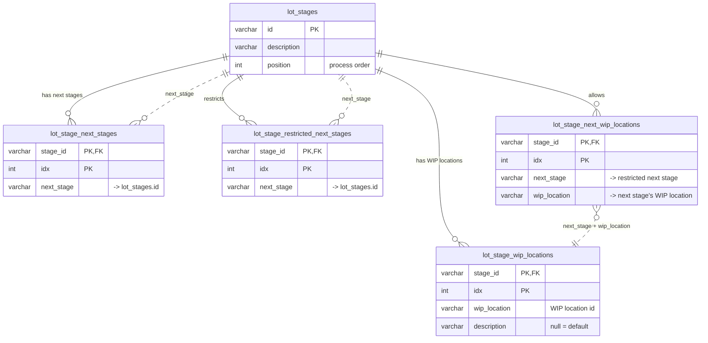

# Lot stage tables — entity relationship diagram

The lot-stage configuration is stored in five tables. `lot_stages` has one row per stage. Four child
tables hold, for each stage, its next stages, its WIP locations, and which WIP locations a lot may be
scanned to in each next stage.

Source: `src/main/resources/db/oracle/create-schema.sql`, which matches the JPA mapping in
`stage/adapter/persistence/LotStageEntity.java`.

## Notes

- **Solid lines** are enforced foreign keys (`fk_ls_*`). Each one goes from a child table's `stage_id`
  to `lot_stages.id`, and deleting a stage requires deleting its child rows first.
- **Dashed lines** are references the database doesn't enforce. The application checks them when a
  stage is updated (`Stage.changeRoutes`), and leaves out stale ones when reading
  (`StageGraph.allowedNextWipLocations`).
- Each child table is an ordered JPA `@ElementCollection` with primary key `(stage_id, idx)`. `idx`
  is the display order and `position` is the process order of the stages.
- `lot_stage_wip_locations.description` is null until set. The API then shows a default made from
  the stage description plus the id's trailing number, e.g. `WAFER-PREP-001` → "Wafer Prep 1".
- **Restricting WIP locations in a next stage:**
  - A next stage with no row in `lot_stage_restricted_next_stages` allows all of its WIP locations.
  - A next stage that has a row there allows only the WIP locations listed for it in
    `lot_stage_next_wip_locations`, possibly none.
  - The two tables are separate so that "restricted to none" can be stored.
